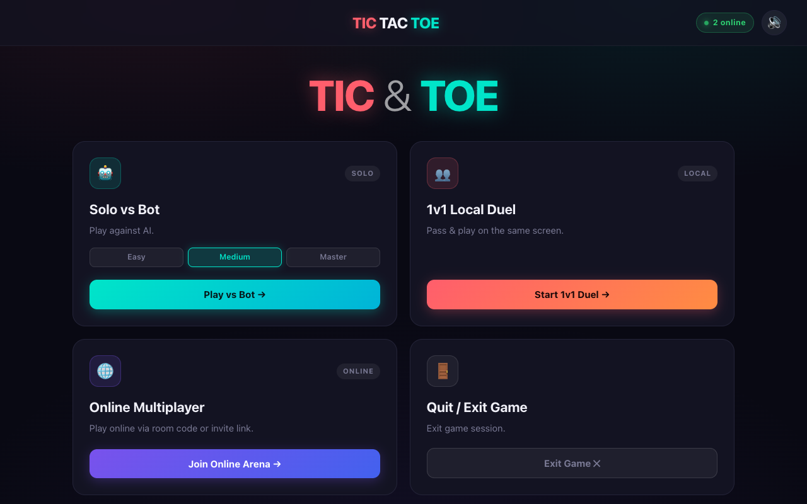
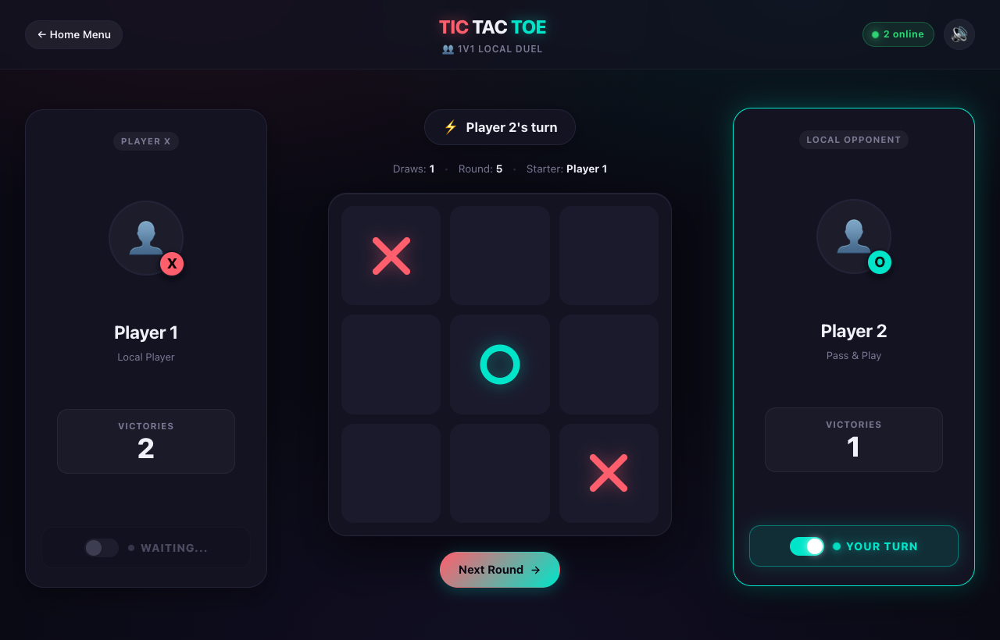

# ✦ Tic-Tac-Toe Arena

Tactical Tic-Tac-Toe with AI bot, local pass-and-play, and real-time WebRTC peer-to-peer multiplayer.

---

### 🌐 Web & Mobile (iPhone, iPad, Android)
Play instantly across desktop and mobile browsers, or install directly to your device home screen:  
👉 **[melvynkui.com/games/tictactoe/](https://melvynkui.com/games/tictactoe/)**

* **📱 iPhone / iPad**: Open in Safari → tap **Share** → tap **Add to Home Screen** for a fullscreen native app experience with zero browser frame.
* **🤖 Android**: Open in Chrome → tap **Install App** to add to your app drawer and home screen.

### 📦 Desktop Apps
Standalone native windows with hardware acceleration and sandboxed security:
* **macOS (Apple Silicon)**: [`TicTacToe-Arena-1.0.0-arm64.dmg`](./TicTacToe-Arena-1.0.0-arm64.dmg) *(in repository root & [Releases](https://github.com/Mel6502-AI/ticktacktoe/releases/download/v1.0.0/TicTacToe-Arena-1.0.0-arm64.dmg))*
* **Windows (PC)**: [`TicTacToe-Arena-1.0.0-win.zip`](https://github.com/Mel6502-AI/ticktacktoe/releases/download/v1.0.0/TicTacToe-Arena-1.0.0-win.zip) *(portable package with `TicTacToe-Arena.exe`)*
* **Linux**: [`ticktacktoe-1.0.0.tar.gz`](https://github.com/Mel6502-AI/ticktacktoe/releases/download/v1.0.0/ticktacktoe-1.0.0.tar.gz) *(standalone Linux package)*
* 📂 All installers: **[GitHub Releases v1.0.0](https://github.com/Mel6502-AI/ticktacktoe/releases/tag/v1.0.0)**

---

### Main Menu

---

### 1v1 Arena

---

### Game Modes
- **🤖 Solo vs Bot**: Built-in AI with Easy, Medium, and Master minimax difficulty.
- **👥 1v1 Local Duel**: Pass & play on the same screen with dual illuminated turn switches.
- **🌐 Online Multiplayer**: Direct WebRTC P2P with 1-click auto-pair matchmaking and private room codes.
